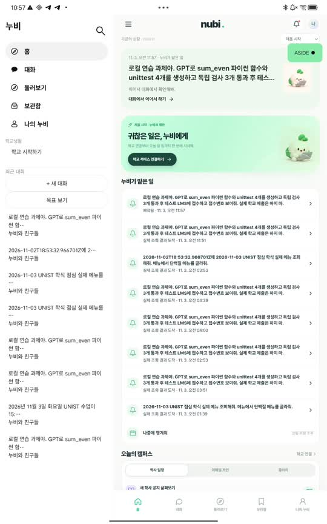
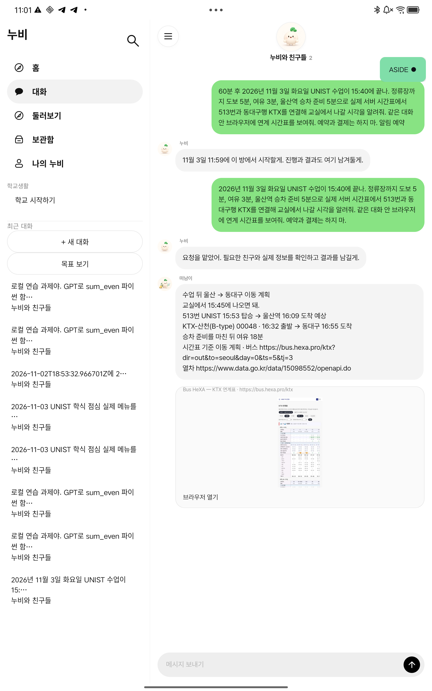
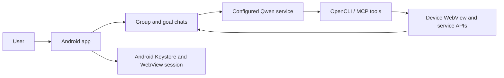

# Nubi · Aside Mobile

Nubi is an experimental Android assistant that brings goal-oriented conversations, campus information, browser tasks, and scheduled work together. It is being developed for phones and tablets, with UNIST campus life as an early use case.

The current source snapshot is based on the `0.6.32-background-browser` development build and source revision `4d77aa0`. It is a work in progress, not a production-ready service.

## What is in this repository

- **Nubi and friends:** a shared conversation for user requests and scheduled tasks, with specialist characters for different goals.
- **Goal conversations:** individual workspaces for fitness, relationships, academics, and home buying.
- **Campus workflows:** prototypes for portal sessions, notices, Blackboard materials, and document and email preparation.
- **Tools and browsing:** a Qwen-backed execution service with OpenCLI/MCP tools and a device WebView. In group chat, the task browser can remain outside the visible viewport while a preview is shown; the user can open it from the chat.
- **Transport:** server-side public-data and timetable integrations, including bus, train, places, weather, air quality, and tourism lookups, plus simulated itinerary-change tests.
- **Local protection:** Android Keystore-backed storage for school credentials and persisted app WebView sessions.

Features depend on the external services, account access, configuration, and the device being used. Browser automation may require the app to be active. Existing sessions can expire, and school or Microsoft sign-in can require additional authentication.

## Screenshots

These are local tablet test captures of the app. The content shown is a test scenario; transit times are historical, not live departures.

| Home and scheduled tasks | Group chat and a transit lookup |
| --- | --- |
|  |  |

## Architecture



The model service, API credentials, external account sessions, and model weights are not included. Transport APIs and other provider integrations require their own configuration and access.

## Build

Requirements: JDK 17, Android SDK platform 35 and build tools, and Gradle compatible with Android Gradle Plugin 8.7.3. The repository does not include a Gradle wrapper.

```sh
git clone https://github.com/hang154/Aside-Mobile.git
cd Aside-Mobile/mobile-aside-mvp
gradle :app:assembleGroupchatDebug
```

The debug build output is under `app/build/outputs/apk/groupchat/debug/`. An APK is not distributed in this repository. The optional local inference engine and model must be set up separately; see the [Android workflow](.github/workflows/android-debug-apk.yml) and [app documentation](mobile-aside-mvp/README.md).

Some local checks can be run without an Android device:

```sh
bash scripts/test_parser.sh
bash scripts/test_actions.sh
bash scripts/test_goals.sh
node scripts/test_goal_extractors.mjs
```

Run these commands from `mobile-aside-mvp/`. Live model, campus, and service tests need their respective credentials and environments.

## Status

The development build has been exercised with a real Qwen service, public transport lookups, a test LMS, and a tablet browser preview. The portal session and sign-in flow have been tested in a specific device environment. The included captures do not demonstrate live reservations, payments, or an actual Blackboard submission.

Automatic transactions, complete provider integrations, reliable background execution under all Android lifecycle conditions, and the full scenario catalogue remain in development. See [vision.md](vision.md) for the intended direction and [reports](reports/) for historical verification records. Some earlier documentation and app text remain in Korean.

## Project layout and history

- [`mobile-aside-mvp/`](mobile-aside-mvp/) — Android app, build configuration, and tests.
- [`opencli-nubi/`](opencli-nubi/) — OpenCLI/MCP adapters, transport services, and execution tools.
- [`docs/`](docs/) — product goals, integration notes, and development history.
- [`reports/`](reports/) — historical test and verification reports.
- [`vision.md`](vision.md) — product direction, experience, and priorities.

The public repository retains its earlier branches and history. This update brings a reviewed source snapshot onto `main`; private development history, account data, recordings, and build artifacts are not included in this update. Earlier screenshots, version descriptions, and reports describe the versions on which they were recorded.

Public availability does not itself grant a software license. Review the applicable licenses and rights for dependencies, services, and assets before redistribution.
