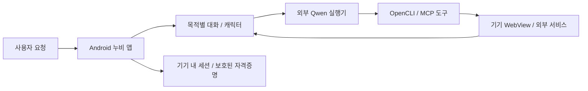

# 누비 · Nubi / Aside Mobile

**하고 싶은 일을 말하면, 목적에 맞는 누비가 탐색과 준비를 돕는 Android AI 에이전트 앱.**

누비는 운동·연애·학점·집 사기처럼 사용자의 목표를 중심으로 대화, 브라우저 탐색, 일정과 문서 작업을 연결하는 프로젝트입니다. 대학생의 학교 공지·과제·메일 확인을 첫 번째 집중 사용 사례로 개발하고 있습니다.

이 저장소는 `hang154`의 **공개 소스·개발 이력 저장소**입니다. 링크로 접속하는 누구나 소스와 커밋을 볼 수 있습니다. 개인 로그인 세션이나 운영 서버를 제공하는 배포 서비스는 아닙니다.

## 지금 볼 버전

- 기본 브랜치 `main`: 기존 제품 `0.6.16`을 바탕으로 영어 UI 문구를 적용한 `0.7.2-existing-en` 소스 (`2c70276`). 공개 소개 문서는 그 위에 별도 커밋으로 추가했습니다.
- `mobile-aside/tablet-llm`: 기존 제품 개발 흐름. 현재 보존 기준 `660ebb8`.
- `demo/existing-only-en-20261102`: 시연 전용 기능을 제외하고 기존 앱만 사용하는 버전.
- `demo/investor-ko-20261102`, `demo/investor-en-20261102`: 이전 촬영용 실험을 보존한 브랜치. 시연 전용 화면이 있으므로 현재 제품의 구현 범위로 보지 않습니다.
- `feature/secure-auth-vault`: Android Keystore 기반 자격증명 저장 실험.
- `archive/private-main`: 이전 비공개 저장소 기본 브랜치의 커밋을 그대로 보존합니다. 컨셉·사업계획과 사용자 요구 정리도 포함합니다.

**원본 커밋의 메시지·부모·SHA와 버전 태그를 보존했습니다.** 파일을 합쳐 과거 커밋으로 위장하거나 이력을 재작성하지 않았습니다. 커밋에 언급된 로컬 절대 경로는 개발 당시 기록이며 공개 다운로드 링크가 아닙니다.

## 제품 컨셉

사용자는 홈에서 현재 맥락과 목표를 보고, 캐릭터와 대화하며 작업을 이어갑니다. 개별 캐릭터 대화와 누비가 여러 캐릭터를 부르는 그룹 대화를 함께 실험합니다.

- **학점 / 똑똑이:** 학교 공지, Blackboard, 학사메일, 과제·시험 일정과 자료 준비.
- **운동 / 건강이:** 운동 목표, 루틴과 관련 콘텐츠 탐색.
- **연애 / 다정이:** 대화 조언, 데이트와 관심 콘텐츠 탐색.
- **집 사기 / 차곡이:** 목표 관리와 관련 정보 탐색.
- 여행·취업 등 기존 작업도 목적별 에이전트의 하위 기능으로 연결합니다.

홈은 중요한 알림, 오늘의 캠퍼스, 목표별 캐릭터, 작업 진입 카드를 보여줍니다. 대화·둘러보기·보관함·나의 누비를 통해 탐색과 저장을 이어갑니다. 일부 맥락 카드는 미리보기이며, 실제 결과는 연결된 서비스에서 확인해야 합니다.

## 구조



- 앱: Java 기반 Android UI와 홈 WebView. 휴대폰·태블릿 화면 대응을 개발합니다.
- 탐색: 가능한 작업은 DOM·텍스트·전용 도구로 처리해 이미지 분석 의존을 줄입니다.
- 모델: 외부 Qwen 서비스와 도구 호출 실행기를 별도 운영합니다. 모델 가중치·API 키·서버 계정은 포함하지 않습니다.
- 학교 연결: 기기 내 포털 세션 보존과 서비스별 연결 확인. SSO와 추가 인증은 실제 서비스 정책에 따라 달라지며 한 번 로그인으로 영구 연결된다고 보장하지 않습니다.
- 문서: 초안 생성과 검토·전달 흐름. 실제 발송·제출·예약·결제는 서비스별 구현 상태와 승인 경계를 확인해야 합니다.

## 소스와 개발 기록

- [Android 앱](mobile-aside-mvp/) / [앱 빌드 안내](mobile-aside-mvp/README.md)
- [OpenCLI · MCP · Qwen 실행기](opencli-nubi/) / [연결 안내](opencli-nubi/README.md)
- [전체 개발 연혁](docs/PUBLIC_DEVELOPMENT_HISTORY.md)
- [공개 보존 브랜치·태그](docs/PUBLIC_VERSION_REFS.json)
- [제품 목표](docs/PRODUCT_GOALS.md) / [사용 시나리오](docs/NUBI_SCENARIOS.md)
- [캠퍼스 연동 목표](docs/NUBI_UNIST_INTEGRATION_GOALS.md)
- [Qwen 사용자 지시 탐색 검증](reports/QWEN_USER_DIRECTED_VERIFICATION.md)
- [기존 앱 전체 조망 검증](reports/EXISTING_APP_OVERVIEW_VERIFICATION.md)
- [검증 보고서 모음](reports/)
- [컨셉·사업계획 개발 기록](https://github.com/hang154/Aside-Mobile/tree/archive/private-main/docs/strategy/nubi-v2-20261102)

## 로컬 빌드

Java 17, Android SDK 35, Gradle 8.10.2 이상을 준비합니다. 저장소에 Gradle wrapper가 없는 환경에서는 설치된 Gradle을 사용합니다.

```bash
git clone https://github.com/hang154/Aside-Mobile.git
cd Aside-Mobile/mobile-aside-mvp
gradle :app:assembleGroupchatDebug
```

기본 산출물은 `app/build/outputs/apk/groupchat/debug/`에 생성됩니다. 로컬 추론을 사용하려면 별도 네이티브 엔진과 모델이 필요합니다. 엔진 준비 방식과 해시 검증은 [Android 빌드 워크플로](.github/workflows/android-debug-apk.yml)를 참고하세요. 외부 Qwen/MCP 사용에는 각 실행기의 별도 환경 설정과 사용자가 로그인한 기기가 필요합니다.

```bash
bash scripts/test_parser.sh
bash scripts/test_actions.sh
bash scripts/test_goals.sh
node scripts/test_goal_extractors.mjs
```

위 명령은 로컬 코드 검사 예시입니다. 학교 계정·휴대폰·외부 서비스가 필요한 실기기 검증을 대체하지 않습니다. 과거 테스트 개수와 성공 기록은 해당 커밋·환경의 결과이며 모든 현재 서비스가 동작한다는 뜻은 아닙니다.

## 구현 범위와 남은 일

기존 보고서에는 실제 Qwen 탐색, 목적별 워크스페이스, 학교 브라우저 세션, Blackboard 자료 조회·다운로드, 화면 탐색과 문서 흐름의 검증 범위를 기록했습니다. 최신 전체 조망 영상은 홈과 5개 탭의 실제 화면 조작을 확인한 것입니다.

모든 외부 서비스의 자동 예약·결제, 실시간 매칭, 통합 가격 감시, 모든 학교 계정의 단일 로그인, 완전한 영어화는 완료된 기능으로 주장하지 않습니다. 기존 대화·원문과 일부 동적 문구는 한국어로 남습니다. 단계별 제약과 재현 조건은 각 보고서를 확인하세요.

## 공개 보관 원칙

원본 커밋 이력을 Gitleaks와 추가 민감 문자열 검사로 확인한 뒤 공개했습니다. 자동 검사만으로 모든 노출 가능성을 보장하지는 않습니다. 캡처·영상·APK, 계정 비밀번호·토큰·쿠키·개인 메일 원문·기기 DB·모델 가중치는 이번 공개 업로드에 포함하지 않았습니다. 검증 미디어는 로컬에 보관합니다.

과거 README의 ‘비공개’ 표현은 당시 저장소 상태를 설명한 기록입니다. 원래 비공개 백업 저장소는 그대로 유지됩니다. 공개 열람 허용과 소프트웨어 재배포 라이선스는 별개이며, 외부 소스·디자인·의존성의 권리와 각 라이선스를 확인해야 합니다.
